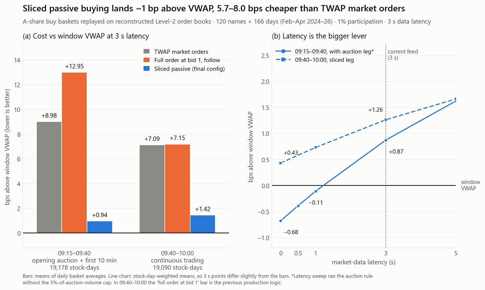
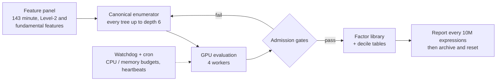
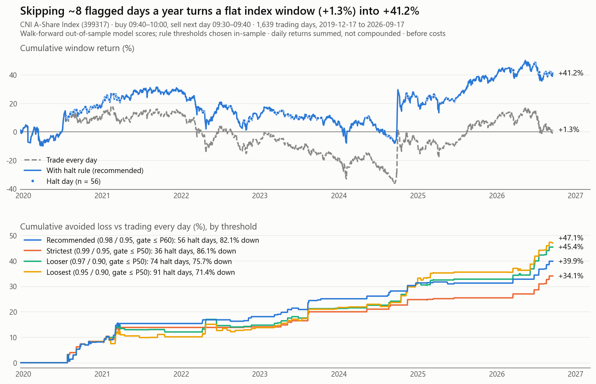
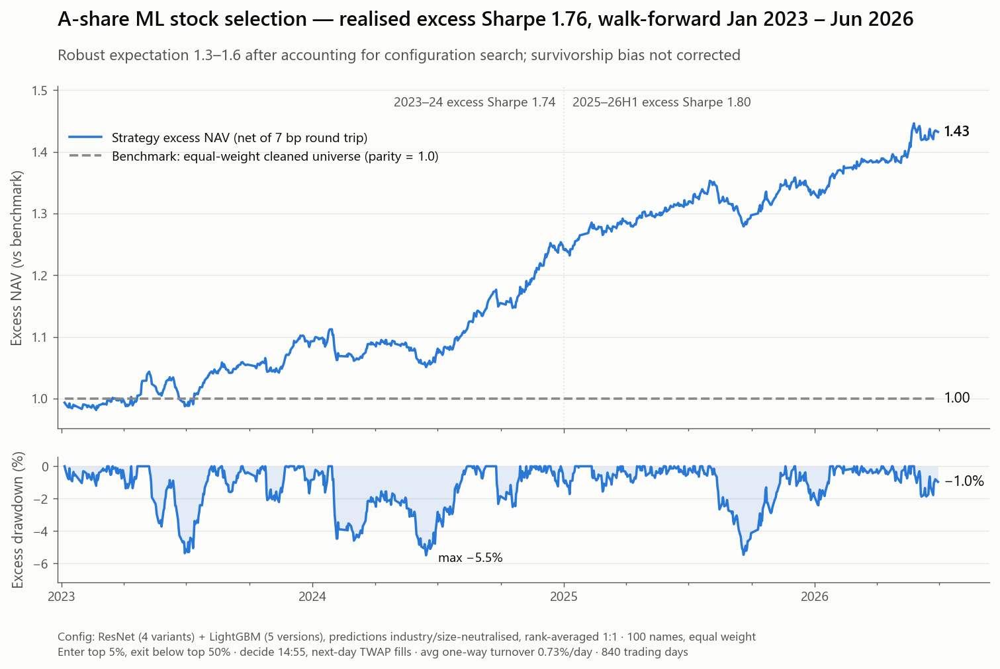
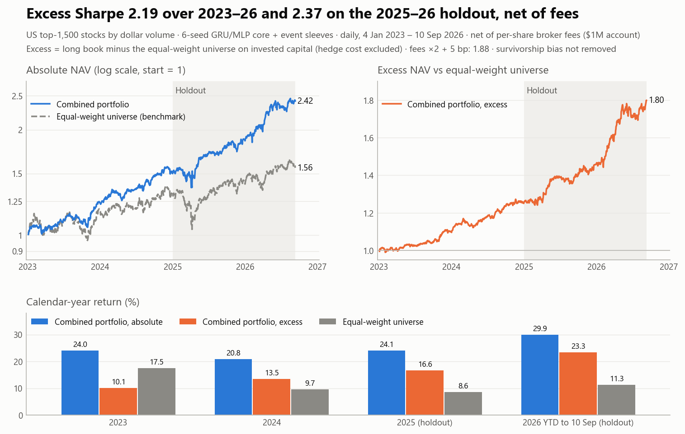

# Qihao Yin: Quantitative Research Portfolio

**MQF, Singapore Management University (2026) · FRM Charterholder**
Quant research intern (systematic equities: China A-shares and US) · co-founder of a proprietary A-share strategy

I build research pipelines end to end, from point-in-time data and factor search through models, execution
and risk control. What I care about most: no look-ahead, numbers that say plainly what was chosen in-sample,
and results that reproduce bit-for-bit from a clean clone.

> Code and data are private (proprietary or employer-owned). Every chart below is regenerated from the
> original result files. Code walk-throughs are available on request.

Contact: qihao.yin.2025@mqf.smu.edu.sg

---

| Project | Headline |
|---|---|
| [Basket execution algorithms (A-shares, Level-2)](#basket-execution-on-a-rebuilt-level-2-order-book) | 8.0 / 5.7 bps cheaper than TWAP market orders over ~19,000 stock-days of tick replay |
| [Exhaustive factor mining engine](#exhaustive-factor-mining-engine) | All formulas up to depth 6 over 143 features, ~3M/day, unattended 24/7 |
| [Index intraday risk-control (halt rule)](#index-morning-halt-rule-china-a-shares) | 56 halt days in 1,639, 82% of them down days; summed window return +1.3% → +41.2% (before costs) |
| [A-share cross-sectional ML stock selection](#a-share-cross-sectional-stock-selection-1d-resnet--lightgbm) | Walk-forward 2023–26 excess Sharpe 1.76 net of costs (1.3–1.6 after search haircut) |
| [US equity multi-strategy (top-1,500 universe)](#us-equity-multi-strategy-top-1500-universe) | Excess Sharpe 2.37 on the 2025–26 holdout, 2.19 over 2023–26 (net of fees) |

---

## Basket execution on a rebuilt Level-2 order book

**Problem.** Buy hundreds of A-share names in the first 45 minutes at or below window VWAP, within China's programmatic-trading limits (300 orders + cancels per second, 20,000 per day per account).

**Approach**
- **Simulator:** event-driven Cython engine rebuilds the book from tick-by-tick L2 orders and trades and re-matches the opening auction with our order inserted; the production executor matches it action for action.
- **Fill model:** price-time queue position; cancels ahead of us advance the queue but never fill us (fixing an earlier model that overstated passive fills).
- **Slicing:** linear schedule, post only the next 30–60 s of quantity, deadline sweep; random clock phase per name, ≤60 order actions per name.
- **Follow-bid:** join bid 1 (+1 tick when the spread allows), re-post when it moves.
- **Auction leg:** buy only when unmatched volume is on the buy side, capped at 5% of auction volume.
- **Ablations:** paired same-stock-day differences, t-stats clustered by day.

**Results** (1% participation, 3 s latency, bps vs window VWAP)

| Window | Stock-days | TWAP market | Full order at bid 1 | Final config | Saving vs TWAP |
|---|---|---|---|---|---|
| 09:15–09:40 | 19,178 | +8.98 | +12.95 | **+0.94** | 8.04 |
| 09:40–10:00 | 19,090 | +7.09 | +7.15 | **+1.42** | 5.67 (t = 50) |

In 09:40–10:00, slicing cuts the basket's daily cost s.d. from 41 to 4.3 bps versus the full-order logic; max 63 order actions per name per day.

**What didn't work**
- It does not beat VWAP. Latency is the bigger lever: ~0.55 bps per second of delay in the opening window, ~0.25 in 09:40–10:00.
- Signal-driven scheduling failed in five tests.

**Stack:** Python, Cython, NumPy. **Code:** private — available on request.

---

## Exhaustive Factor Mining Engine

**Problem.** Genetic-programming factor search is path-dependent: it rediscovers the same families, misses simple formulas, and is hard to reproduce. The goal was complete, deterministic coverage of the formula space up to a fixed depth, with admission rules strict enough that whatever comes out is usable in a multi-factor model.

**Approach**
- Enumerates every expression tree up to depth 6 in a fixed canonical order (one stream per exact depth, ascending node count). The only things skipped are commutative swaps and idempotent repeats, with no heuristic pruning, so a run is exactly resumable from a shared cursor.
- Admission requires a predictive-power gate **and** correlation ≤ 0.5 with Barra-style risk exposures **and** ≤ 0.7 with factors already admitted **and** clean decile monotonicity (rank correlation ≥ 0.9 across cross-validation segments, long–short positive in ≥ 80% of folds). The test segment is never used for selection.
- Every 10 million expressions the engine writes a report of admitted factors, archives it and resets the library, so later cycles are not biased by earlier admits.
- Runs unattended 24/7 on a shared 128-core / 2-GPU server: cron restart, heartbeat-based watchdog, a CPU-thread budget and a hard memory cap so it never starves other users.

| Metric | Value |
|---|---|
| Search space | all expressions up to depth 6 over 143 features |
| Throughput | ~35 expressions/s (~3M per day), one 10M cycle ≈ 3.3 days |
| Resource budget | ≤ 25 CPU threads, ≤ 200 GB RAM, 1 GPU |

**Stack.** Python, PyTorch (CUDA), Polars, NumPy, bash / cron.
**Code:** private — available on request.

---

## Index Morning Halt Rule (China A-shares)

**Problem:** at 09:40 each day, decide whether to skip a long window on the CNI A-Share Index (buy 09:40–10:00, sell next day 09:30–09:40) because today looks unusually dangerous.

**Approach**
- **Features:** 654 point-in-time features: index and futures minute bars, market-wide order flow and bid/ask imbalance, limit-up dynamics, prior-day state, overnight global markets.
- **Model families:** 13 LightGBM models in 4 families; each score becomes a real-time percentile against its own past 250 out-of-sample scores, then is averaged within its family.
- **Rule:** halt when a family ranks today in its top 2% (or two families both in their top 5%) and a gate on yesterday's limit-up stocks' 09:40 order imbalance holds.
- **Point-in-time discipline:** walk-forward training ends two days before each prediction; truncated-rebuild and future-noise audits pass.
- **Reproducibility:** a clean clone plus the data release retrains all 13 models and reproduces every decision exactly.

| Threshold (R2 / R3 / gate) | Halt days | Down-day hit rate | Cum. avoided loss |
|---|---|---|---|
| 0.99 / 0.95 / ≤P50 | 36 | 86.1% | +34.1% |
| **0.98 / 0.95 / ≤P60 (recommended)** | **56** | **82.1%** | **+39.9%** |
| 0.97 / 0.90 / ≤P50 | 74 | 75.7% | +45.4% |
| 0.95 / 0.90 / ≤P50 | 91 | 71.4% | +47.1% |

1,639 trading days (2019-12-17 to 2026-09-17): +41.2% with the rule vs +1.3% trading every day.

**Caveats:** before costs; returns summed, not compounded; single instrument. Thresholds, features and model structure were chosen in-sample, so the expected live hit rate is about 76–80%.

**Stack:** Python, pandas, NumPy, LightGBM, Parquet, matplotlib, Jupyter.

**Code:** private — available on request.

---

## A-share Cross-Sectional Stock Selection (1D-ResNet + LightGBM)

**Problem.** Each day, hold ~100 A-shares long-only that beat the equal-weight tradable universe after costs, using only pre-close information.

**Approach**
- **Tradable label:** decide at 14:55, buy next morning via TWAP; limit-up names are unbuyable. Lesson learned: an early long-only result came entirely from limit-up stocks that can't be bought at the close, and vanished once fills were modelled.
- **Clean universe:** no ST, recent IPOs, post-suspension cool-down, banks or tiny caps.
- **Models:** 1D-ResNet (4 hyper-parameter variants, averaged) on 60–120-day sequences of prices and 46 factors; LightGBM (5 versions across retrain frequency and label horizon, rank-smoothed) on 67 factors. Expanding-window walk-forward training.
- **Cross-sectional de-meaning** of inputs and labels; without it the network memorises the date.
- **Neutralise predictions, not targets:** removing industry and size from model outputs worked; neutralising labels and features before training hurt both models.
- **Wide exit band:** enter top 5%, sell only below top 50%.

**Results** (Jan 2023 – Jun 2026, 840 days, 7 bp round trip on actual turnover; enter 5% / exit 50%, equal weight)

| Signal, names | Excess Sharpe | 2023–24 | 2025–26H1 | Excess ann. | Excess max DD | Turnover/day |
|---|---|---|---|---|---|---|
| ResNet only, 100 | 0.92 | 1.58 | 0.00 | 6.7% | −12.2% | 2.98% |
| LightGBM only, 100 | 0.59 | 0.75 | 0.34 | 3.4% | −5.9% | 0.31% |
| **Ensemble 1:1, 100 (charted)** | **1.76** | **1.74** | **1.80** | **11.0%** | **−5.5%** | **0.73%** |
| Ensemble 1:1, 80 | 1.77 | 1.66 | 1.95 | 11.5% | −5.7% | 0.73% |

**Caveats**
- Rules and model mix were chosen on this window: the charted config is in the top 9% of 3,840 searched ≤100-name configurations (median 1.40). Robust expectation: 1.3–1.6.
- Survivorship bias: delisted stocks are missing from the data; not corrected.
- Long-only, unhedged (absolute max drawdown −34.5%); no slippage or impact modelled.

**Stack:** Python, PyTorch, LightGBM, NumPy, pandas, Polars. **Code:** private — available on request.

---

## US Equity Multi-Strategy (Top-1,500 Universe)

**Problem:** a daily long book on the 1,500 most liquid US stocks that beats the equal-weight universe after realistic fees, in a look-ahead-audited backtest.

**Approach**
- **Universe:** top 1,500 common stocks by 60-day dollar volume, rebuilt daily from T−1 data.
- **Features:** 33 daily factors plus 85 intraday microstructure features from minute bars, cut at 15:44.
- **Core model:** GRU and MLP trained on 1- to 20-day horizons (10-day head used), retrained yearly walk-forward, 6 seeds averaged. Buy the top 3%, sell below the top 40%, ≤10% turnover a day, closing auction.
- **Event sleeves:** a pullback sleeve and an event × style-bucket sleeve; blend weights set on 2023–24 only.
- **Costs:** IBKR per-share commission plus regulatory fees on every fill ($1M account), +2 bp half-spread on 10:00 entries.

| Period | Excess ann. return | Excess Sharpe | Max DD (excess / absolute) |
|---|---|---|---|
| 2023–24 (tuning) | 11.9% | 2.15 (worse year 1.94) | −4.1% / −8.6% |
| **Jan 2025–Sep 2026 (holdout)** | **24.2%** | **2.37** | **−5.0% / −12.3%** |
| 2023–Sep 2026 (full) | 17.4% | 2.19 | −5.0% / −12.9% |

Excess = long book minus the equal-weight universe on invested capital (no hedging cost). Absolute: 27.2% a year, Sharpe 1.66.

**Robustness** (worse tuning year / holdout / full): median of all 20 three-of-six seed subsets 1.79 / 2.40 / 2.15; fees ×2 plus 5 bp slippage 1.87 / 1.97 / 1.88.

**Caveats:** survivorship bias is not removed (the data misses many post-2022 delistings; earlier estimate ±0.1 Sharpe). The holdout informed model and seed choices; live trading is the true test. A three-way audit fixed 14 look-ahead and data issues, including split-adjusted minute bars that leaked future splits via shares-per-trade and price rounding; all figures are post-fix.

**Stack:** Python, PyTorch (CUDA), LightGBM (baselines), NumPy, pandas, Polars, Parquet, matplotlib.

**Code:** private — available on request.
